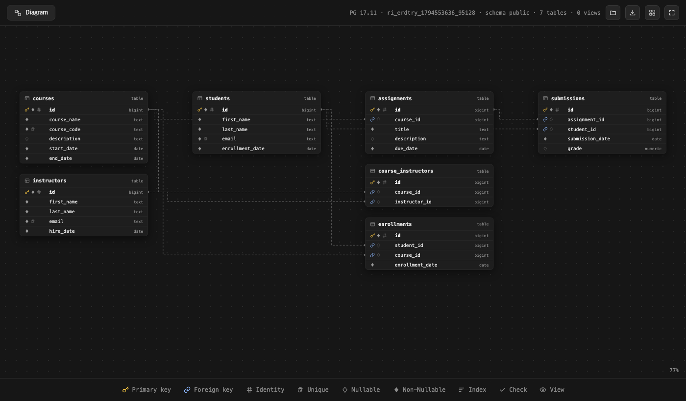
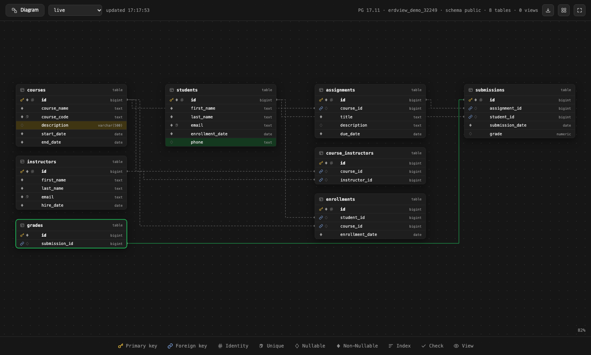
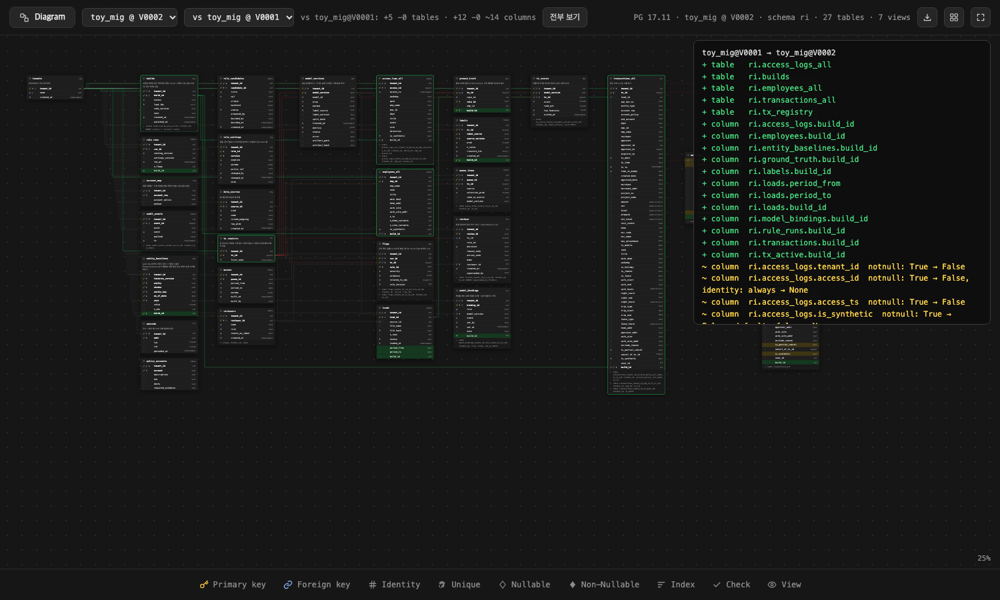

# erdview

Interactive ERD for any database, from one HTML file. Read-only; nothing leaves your machine.



- One read-only query reads the catalog (tables, columns, keys, indexes, comments). Never row data.
- The viewer is a single HTML file: pan, zoom, drag tables, click a column to light up its relations, hover for comments.
- "Save with data" gives you one file to send to anyone. They double-click it.
- PostgreSQL natively (12+). MySQL, SQLite, SQL Server, BigQuery, Snowflake and more through [tbls](https://github.com/k1LoW/tbls) JSON.

## Use

| You | Run |
|---|---|
| Have a terminal and [uv](https://docs.astral.sh/uv/) | `uvx --from git+https://github.com/minkyojung/erdview erdview open postgresql://user@host:5432/db` |
| Prefer pip | `pip install git+https://github.com/minkyojung/erdview` then `erdview open <url>` |
| Use a coding agent (Claude Code, Cursor, Codex…) | Copy `skills/erdview/` into your project's `.claude/skills/` (or paste `skills/erdview/AGENTS.md` into your `AGENTS.md`). Then: "show me the ERD" |
| Have another database | `brew install tbls`, then `tbls out -t json \| erdview open -` (see tbls docs for the `dsn`) |
| Just want to look | Open the `erd_*.html` someone sent you. No install |
| Have no Python at all | Download `viewer.html`, open it, press **Copy SQL**, run it in your SQL client, paste the result |

`SOURCE` can be a PostgreSQL URL, a JSON file (erdview or tbls format), or `-` for stdin. Omit it to use `$DATABASE_URL`.

```
erdview open   [SOURCE]            draw and open in the browser
erdview export [SOURCE] -o erd.html  one self-contained file to share
erdview schema [SOURCE]            the schema as JSON (for agents, diffs, other tools)
erdview sql                        the query it runs
erdview serve  [SOURCE] --source NAME=SPEC ... [--pg ADMIN_URL]
                                   live local viewer: a dropdown to pick a source, changes painted within 2 s
erdview diff   A B [--json]        what changed from A to B, as lines (+ added, − removed, ~ changed); exit 1 when different
                                   A/B: a SOURCE or a migration folder at a version, e.g. db/migration@V0002 (needs --pg)
```

### Live mode and versions

```
erdview serve --source toy=postgresql://…/app --source spring=db/migration --pg postgresql://postgres@localhost/postgres
```



- The page polls the server every 2 s. New tables and columns turn green, changed columns yellow, removed ones red for a few seconds. Tables keep their places.
- A folder of migrations (`V0001__x.sql` Flyway style or `0001_x.sql`) becomes one dropdown entry per version: `spring @ V0001`, `spring @ V0002` … Each version is built by applying the files in order to a throwaway database on `--pg` (needs CREATEDB), then dropped. Results are cached until a file changes.
- **Compare**: pick a second entry in the "vs …" dropdown and the differences stay coloured (tables and columns only in the other version are drawn in red) with the list as text in the corner. `erdview diff` prints the same list for PRs and agents:

```
$ erdview diff db/migration@V0001 db/migration@V0002 --pg postgresql://postgres@localhost/postgres
db/migration@V0001 → db/migration@V0002
+ table   ri.builds
+ column  ri.transactions_all.merchant_region
~ column  ri.attendance_all.weekday  notnull: True → False
```



- `#focus=table` in the URL shows only that table and its neighbours.
- The server listens on 127.0.0.1 only; URLs and paths never reach the page.

## What it reads

Tables, partitioned tables (not their partitions), views, materialized views, foreign tables; columns with type, nullability, default, identity/serial/generated, comment; primary/unique/foreign keys with column order and on-delete/update, checks, exclusions; the other indexes; which tables a view reads. Extension-owned objects and system schemas are skipped. To limit schemas, edit `only_schemas` at the top of the SQL.

From tbls JSON the same, minus identity/generated flags (tbls does not record them).

## Develop

```
python -m venv .venv && .venv/bin/pip install -e '.[dev]'
.venv/bin/pytest -q          # needs Postgres (ERDVIEW_TEST_PG=postgresql://postgres:x@localhost:5433/postgres) and Chrome; skips otherwise
```

`erdview/pg_erd.sql` is the source of truth for the query. After changing it, paste it into the `#erd-sql` block of `erdview/viewer.html`; a test checks they match.

MIT.
